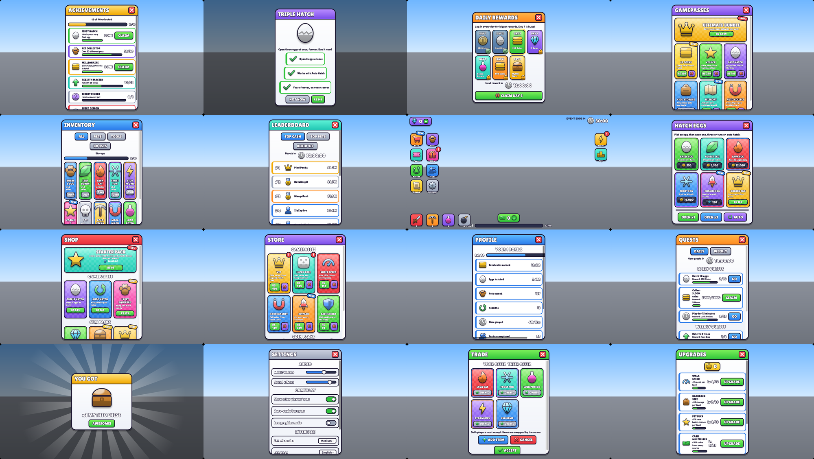
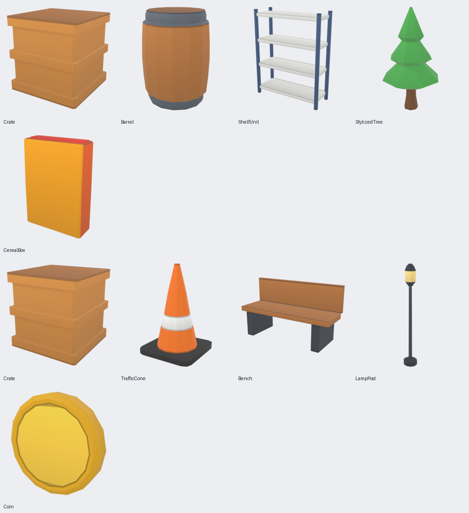

# UltimateRobloxKit

A Roblox development ecosystem for Claude Code and compatible AI coding agents:

- **67 skills**, a router that loads only the skills a task needs (measured on held-out tasks), and 13 subagents
- **A Luau library**: 36 game systems (including pets and eggs, rebirths, upgrades, worlds, boosts, trading, VFX tiers and world layouts) and UrkUI, a tag-based UI framework
- **A game-style UI generator**: describe a screen and get a working Luau interface built from a validated spec, a 19-component cartoon kit, and design tokens
- **272 original icons** plus **203 CC0 Kenney icons** and the Kenney UI Pack, and an asset pipeline that builds Roblox-ready models with LODs and collision hulls in Blender
- **A game generator**: `urk generate "supermarket simulator with 50 products"` assembles a project that builds and passes its tests
- **Tooling**: Rojo templates, Wally packages (Fusion, Promise, ProfileStore), an economy simulator, an asset registry, a visual UI scoring loop, security audit, release gate, project memory, a dashboard, and one `urk` command for all of it



*The 16 built-in screen specs, rendered by `urk.py ui preview` from the same tokens and icons the Luau builder uses. This is an HTML preview; the real UI is built in Roblox by `Spec/Builder`. See the [UI quick start](docs/workflows/ui-quickstart.md).*



*Ten assets from `examples/asset-batch/props.json` and `templates/asset-pipeline/specs/batch-01.json`, generated, exported to FBX, OBJ and GLB, re-imported and rendered by `scripts/export/asset_batch.py`.*

## What you get

| Area | Contents |
|---|---|
| **Luau library** (`library/`) | 36 systems: pets and eggs, rebirth, upgrades, worlds, boosts, trading, progression, VFX, world generation, inventory and hotbar, pickup, equipment, crafting, resources, shop, currency, save data, settings, quests, achievements, daily rewards, leaderboards, NPC, dialogue, zones, checkpoints, vehicles, placement, binder, rounds, teams, matchmaking, notifications, loading, input, analytics. Pure rules are tested with Lune; server-authoritative adapters. [Index](library/README.md) |
| **UrkUI** (`library/src/UI/`) | Tag- and attribute-driven UI: panels, actions, live data binding, tabs, tooltips, toasts, context menus, drag and drop, components, dark/light/high-contrast themes, phone-to-console layouts, gamepad navigation, localisation, animation. [Reference](library/src/UI/README.md) |
| **UI generation** (`library/src/UI/{Style,Game,Spec}`) | Design tokens (`design/tokens/styles.json`, styles cartoon, midnight and pastel), 19 game components (GameWindow, ProductCard, PromoBanner, CartoonButton, Badge, CurrencyCounter, LevelBar, Timer, Toggle, Slider, Dropdown, RewardPopup and more), 20 motion presets, text fitting, 16 ready screen specs (shops, HUD, daily rewards, inventory, pets, upgrades, quests, achievements, settings, leaderboard, profile, trading, popups), a validated spec format and a builder. `urk.py ui new / validate / preview`. [Architecture](docs/architecture/ui-generation.md) |
| **Icons** (`assets/icons/`) | 272 original MIT icons: tintable glyphs, illustrated cartoon versions with thick outlines and highlights, and rarity or colour variants. Includes sprite sheets, a catalog, auto-alignment, a style validator, a gallery, a Luau API, and an importer for packs you download under their own licence |
| **Skills** (`skills/`) | 67 skills in 9 categories, including 12 for UI: design, generator, icon design, shop builder, animation, responsive layout, design system, audit, performance, asset pipeline, testing and reference recreation. [Catalog](docs/references/skill-catalog.md) |
| **Orchestration** | `roblox-kit-router`, `roblox-project-planner`, `catalog/workflows.json`, and `route.py`, a deterministic router evaluated on 32 tuned and 20 held-out tasks (`urk skills eval`) |
| **Agents and commands** (`.claude/`) | 13 subagents with file-ownership rules ([cooperation](docs/architecture/agent-cooperation.md)) and 6 `/urk-*` slash commands |
| **`urk` CLI and dashboard** | `urk.py setup | new | add | generate | packages | check | build | audit | release | economy | assets | ui | skills | memory | upgrade | uninstall | icons | dashboard`, and a self-contained HTML dashboard with Project, UI Playground, Assets, Agents and Tests centres |
| **Security** | Backdoor scanner for scripts and models (`scripts/security/`), checksum-pinned CI tools, a secrets scan |
| **Asset pipeline** | `tools/rbxasset` (73 parameterized generators, UV atlas, safe areas, Blender-free validation) and `scripts/blender` (build, FBX/OBJ/GLB export, re-import check, renders), plus QA, contact sheets, approval gates and the `handoff/License<N>` delivery format, with the 51 approved supermarket objects as references |
| **Templates** (`templates/`) | Rojo projects with pinned tools (starter game, simulator, tycoon, obby, UI kit), plus an asset-pipeline layout |
| **Integrations** | Wally packages and bridges (`ProfileStoreAdapter`, `FusionBridge`), Blender MCP (isolated, telemetry off), Roblox Studio MCP config, environment doctor, pinned third-party skill fetcher |
| **Validation** | Python suite plus about 680 Lune specs; CI on Linux, Windows and macOS runs Blender 4.2, Selene, StyLua, luau-analyze, Lune and Rojo builds |

## Quick start

```bash
git clone https://github.com/Hmza18/UltimateRobloxKit.git
```

```bash
python3 UltimateRobloxKit/urk.py new simulator MyGame ~/games/MyGame
```

```bash
python3 UltimateRobloxKit/urk.py setup --project ~/games/MyGame
```

`setup` checks your machine, installs the skills, agents and commands, adds the UI framework and icons to the project, and validates the configuration. Add `--dry-run` to preview it, `--profile code|assets|ui|design` to install less, and `--with-mcp` to register the Blender and Studio MCP servers. Add game systems with `python3 UltimateRobloxKit/urk.py add Systems/Inventory Systems/Shop --project ~/games/MyGame`.

Then open a new Claude Code session in `~/games/MyGame` and describe what you want. A few examples:

- "Build a Roblox simulator with pets and rebirths" → `new-game` workflow
- "Create 20 supermarket products" → `asset-batch` workflow, in batches of five with an approval stop after each
- "Players lose their data sometimes" → `roblox-data-persistence`
- `/urk-route add a shop with a currency` shows the plan before any work starts

Python 3.9 or newer is the only requirement for the installer, router and validators. Blender, Rojo and Studio are needed only for the workflows that use them. Run `/urk-doctor` or `python3 scripts/install/doctor.py` to see what is missing.

More: [Quick start](docs/getting-started/quick-start.md) · [Beginner setup](docs/getting-started/beginner-setup.md) · [Advanced setup](docs/getting-started/advanced-setup.md)

## How skill selection works

Claude Code reads every installed skill's short description and activates the ones that match. With 67 skills, the kit adds a second layer so context stays small:

1. The `roblox-kit-router` skill holds a one-line index of every skill and ten workflow recipes.
2. `route.py` maps a task to a workflow and to trigger matches, then adds only direct dependencies. "Create 20 supermarket products" loads 10 skills, not 61.
3. Long material lives in each skill's `references/` folder and is opened only when the skill says so.

See [Agent architecture](docs/architecture/agent-architecture.md).

## Common commands

| Task | Command |
|---|---|
| Set up a project (everything) | `python3 urk.py setup --project <dir>` |
| Add library systems | `python3 urk.py add --list`, then `python3 urk.py add UI Systems/Quests --project <dir>` |
| Check a project | `python3 urk.py check <dir>` |
| Upgrade safely | `python3 urk.py upgrade --project <dir> --dry-run` |
| Browse everything | `python3 urk.py dashboard --open` |
| Find an icon | `python3 urk.py icons search coin` |
| New screen from a template | `python3 urk.py ui new PetSimShop --name MyShop --project <dir>` |
| Validate or preview a screen spec | `python3 urk.py ui validate <spec.json>` / `python3 urk.py ui preview <spec.json> --open` |
| Scan a free model | `python3 scripts/security/scan_models.py Model.rbxmx` |
| Install skills only | `python3 scripts/install/install.py --target <dir>` |
| Install for all projects | `python3 scripts/install/install.py --user` |
| Install selected skills | `... --skills roblox-networking,roblox-ui-systems` or `--category modeling` |
| Update or uninstall | `... --update` / `... --uninstall` |
| Check the machine | `python3 scripts/install/doctor.py --project <dir>` |
| Route a task | `python3 scripts/automation/route.py "<task>"` |
| New game from a template | `python3 scripts/automation/new_project.py --template simulator --name MyGame --out <dir>` |
| Build an asset batch | `python3 scripts/export/asset_batch.py examples/asset-batch/props.json --out build/props` |
| Deliver an approved batch | `python3 scripts/export/package_batch.py build/props --license 12 --dest handoff` |
| Fetch reviewed third-party skills | `python3 scripts/install/third_party.py list` |
| Run all kit checks | `python3 scripts/validate/run_all.py` |
| Generate a whole game | `python3 urk.py generate "pet simulator with 3 worlds and 24 pets" --name PetLand --out <dir>` |
| Add Fusion, Promise, ProfileStore | `python3 urk.py packages --project <dir>` |
| Lint, test and build a game | `python3 urk.py build --project <dir>` |
| Security and licence audit | `python3 urk.py audit --project <dir>` |
| Release gate (never publishes) | `python3 urk.py release check --project <dir>` |
| Balance an economy | `python3 urk.py economy sim tools/economy/examples/pet-sim.json` |
| Reuse an asset | `python3 urk.py assets scan`, then `assets suggest "gold coin"` or `assets dupes` |
| Match a UI to a reference | `python3 urk.py ui extract ref.png`, then `ui compare ref.png capture.png --diff d.png` |
| Measure routing | `python3 urk.py skills eval` |
| Project memory | `python3 urk.py memory add decision "..." --project <dir>` |

## Documentation

- Getting started: [quick start](docs/getting-started/quick-start.md), [beginner setup](docs/getting-started/beginner-setup.md), [advanced setup](docs/getting-started/advanced-setup.md), [installation](docs/getting-started/installation.md)
- Workflows: [generate a game](docs/workflows/generate-game.md), [UI quick start: a shop in five commands](docs/workflows/ui-quickstart.md), [new game](docs/workflows/new-game.md), [Blender assets](docs/workflows/blender-assets.md), [asset export](docs/workflows/asset-export.md), [Roblox Studio](docs/workflows/roblox-studio.md), [Studio validation](docs/workflows/studio-validation.md), [MCP integration](docs/workflows/mcp-integration.md), [templates](docs/workflows/templates.md), [skill usage examples](docs/workflows/skill-examples.md)
- Architecture: [blueprint](docs/architecture/BLUEPRINT.md), [agent architecture](docs/architecture/agent-architecture.md), [repository layout](docs/architecture/repository-layout.md), [skill format](docs/architecture/skill-format.md)
- Library: [index](library/README.md), [UrkUI](library/src/UI/README.md), [Game components](library/src/UI/Game/README.md), [screen specs](library/src/UI/Spec/README.md), [playground](library/examples/playground/README.md), [UI generation architecture](docs/architecture/ui-generation.md), [conventions](docs/architecture/library-conventions.md), [icon licences](assets/icons/LICENSE.md)
- Reference: [roadmap](docs/references/roadmap.md), [research V2](docs/references/research-v2.md), [skill catalog](docs/references/skill-catalog.md), [repository evaluation](docs/references/repository-evaluation.md), [recovered supermarket pipeline](docs/references/recovered-supermarket-pipeline.md), [validation status](docs/references/validation-status.md)
- [Troubleshooting](docs/troubleshooting/README.md) · [Contributing](CONTRIBUTING.md) · [Security](SECURITY.md) · [Sources](SOURCES.md) · [Third-party notices](THIRD_PARTY_NOTICES.md) · [Third-party resources](THIRD_PARTY_RESOURCES.md) · [Changelog](CHANGELOG.md)

## What is and is not verified

Automated tests cover the installer, `urk` CLI, router, skill structure, links, geometry kit, icons, scanner, third-party fetcher, game generator, economy simulator, asset registry, visual scoring, audit, memory and release tools, and the Blender pipeline including LODs and collision hulls (Blender 5.2.3 locally and 4.2 LTS in CI). In CI they also cover the library's pure logic (Lune), lint, format and Rojo builds. **Library adapters (including the new Pets, Progression and Trading servers, VFXClient and WorldGenBuilder), UrkUI runtime behaviour, Roblox Studio import, Studio MCP and Studio screenshots were not exercised**, because Studio was not available on the build machine. Those workflows are documented as manual procedures, and the scripts report them as `NEEDS MANUAL REVIEW`. Details: [validation status](docs/references/validation-status.md).

## License

MIT, see [LICENSE](LICENSE). Third-party skills are never bundled. They are fetched at reviewed, pinned commits, together with their own licenses.
