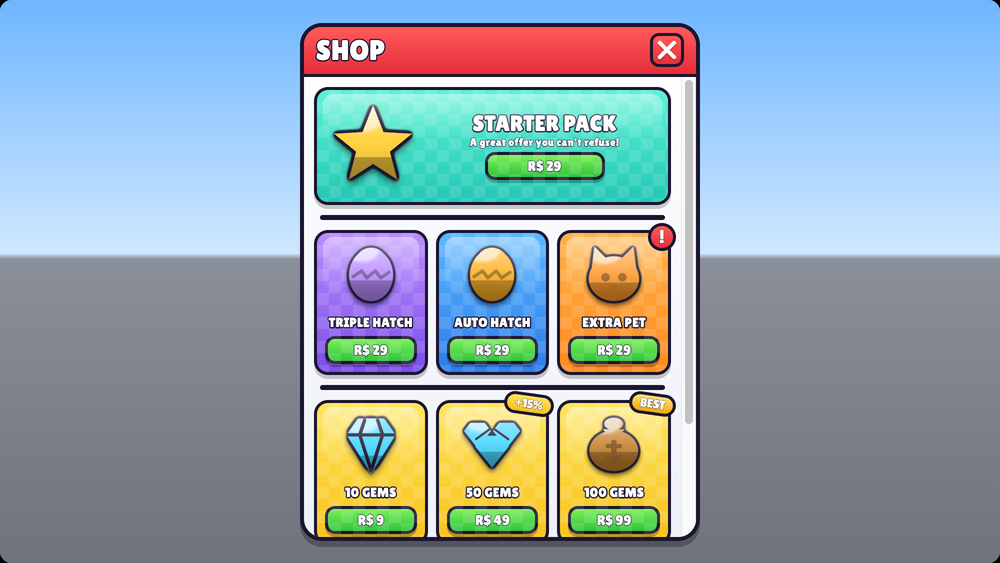

# Quick start: a professional Roblox shop in five commands

This builds a simulator-style shop with a featured starter pack, colour-coded product cards, Robux buttons, badges and animations. It uses the kit's real UI framework (UrkUI with its Game components and screen specs), not mockups.



*Spec preview of `tests/fixtures/ui-specs/valid/pet-shop.json`. It is an HTML approximation built from the same tokens and icons as the Roblox builder. The real UI renders in Studio (see step 5).*

## 1. A game with the UI library

```bash
python3 urk.py new starter-game MyGame ~/games/MyGame
```

```bash
python3 urk.py setup --project ~/games/MyGame --profile ui
```

`setup` installs the UI skills and copies UrkUI, its Game components, the screen builder and the icons into `src/shared/Urk/`.

## 2. Start from a ready screen

```bash
python3 urk.py ui list
```

```bash
python3 urk.py ui new PetSimShop --name MyShop --project ~/games/MyGame
```

This writes `src/shared/UrkScreens/MyShop.json`, the screen spec you edit, and `src/client/Screens/MyShop.client.luau`, which builds and opens it.

## 3. Make it yours

Edit the JSON: titles, palettes (`red orange yellow green teal blue purple pink gold gray`), icons (`python3 urk.py icons search egg`), prices and badges. A product card looks like this:

```json
{ "type": "product", "id": "autoHatch", "palette": "blue", "icon": "egg-legendary", "title": "AUTO HATCH",
  "price": { "kind": "robux", "amount": 29, "gamePassId": 123456 }, "badge": { "kind": "attention" }, "gift": true }
```

Check and look at it without Studio:

```bash
python3 urk.py ui validate ~/games/MyGame/src/shared/UrkScreens/MyShop.json
```

```bash
python3 urk.py ui preview ~/games/MyGame/src/shared/UrkScreens/MyShop.json --open
```

Or ask Claude: "Create a pet simulator shop with six products, colorful cards, Robux buttons, and a featured starter pack." The `roblox-ui-generator` skill turns that into a spec, validates it and previews it.

## 4. Purchases, the safe way

- The UI only sends intents. `Game/PurchaseBridge` prompts Roblox purchases on the client.
- Granting happens only on the server, through `Systems/Shop`: `ProcessReceipt` for developer products and an ownership check for game passes. See the `roblox-shop-builder` skill.
- Currency prices fire a `Buy` intent, and your server validates and charges with `Systems/Currency`.

```bash
python3 urk.py add Systems/Shop Systems/Currency --project ~/games/MyGame
```

## 5. See it in Studio

1. In the project, run `rokit install`, then `rojo serve`. In Studio, open the Rojo plugin and connect.
2. Upload the icon sprite sheets (`assets/icons/urk/sheet-*.png`) once and call `Icons.configure({ sheets = { ... } })`. Until then, icons show as empty images.
3. Press Play. The shop opens with its open animation. Try it in the Device emulator at phone, tablet and console sizes.

For a component-by-component tour, run the playground in `library/examples/playground` (see its README).

## What to read next

- `roblox-ui-design` and `roblox-design-system` cover the look, the tokens and new themes.
- `roblox-icon-design` covers adding original icons.
- `roblox-responsive-layout` and `roblox-ui-audit` cover making every screen work on every device.
- [UI generation architecture](../architecture/ui-generation.md) covers the spec format and component APIs.
