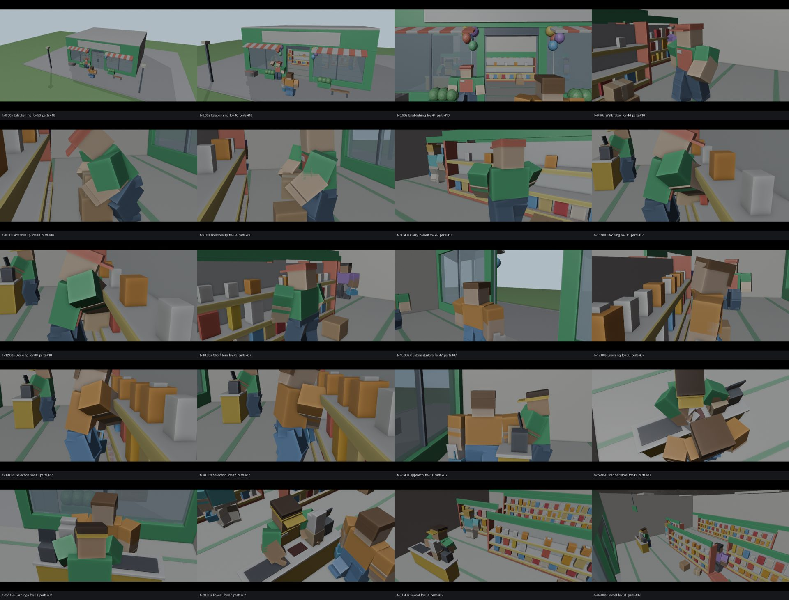

# Supermarket Simulator intro: "YOUR SUPERMARKET JOURNEY BEGINS"

A 35-second, removable intro cinematic for a Roblox supermarket simulator, as a Rojo project. It plays locally for each player, then hands the game back exactly as it was.

**Status: built and tested outside Roblox Studio. It has not been run in Studio.** The session that built it had no Studio or Studio MCP connection. See [Verification](#verification) for what was exercised and what still needs a person in Studio.

*Previs: the real runtime played headless, with every part and the camera at 20 story beats rendered in Blender. Text, particles, UI and Roblox lighting are not shown.*

## The five scenes

| Time | Scene | What happens |
|---|---|---|
| 0:00 to 0:06 | The Grand Opening | Crane shot down to the storefront. The sign lights up, the doors slide open, the employee waves, confetti bursts and a "GRAND OPENING!" badge pops in. |
| 0:06 to 0:14 | Stocking the Shelves | The employee walks to a box, bends, grips and lifts it, carries it to the half-empty shelf and shifts it onto one arm. They place three products by hand, then the rest of the shelf fills in a staggered drop-in cascade with sparkles and highlights. |
| 0:14 to 0:21 | The First Customer | A customer with a basket walks in, browses with a hand on the chin, picks the product the employee placed, drops it in the basket and heads for checkout. |
| 0:21 to 0:28 | Checkout Satisfaction | Items arc from the basket onto the counter. The cashier grabs, sweeps and releases each one; at each beep the scanner pulses green, "+$25" / "+$18" floats up and the register total counts up. Confetti marks checkout success. |
| 0:28 to 0:35 | Your Supermarket Empire | An accelerating pull-back from the checkout to a high wide hero shot of the busy store. Shoppers browse and the staff cheer. The title "YOUR SUPERMARKET JOURNEY STARTS NOW" pops in word by word with a shine, then "BUILD • STOCK • SELL • EXPAND". A white fade hands back to gameplay. |

The earnings numbers are cinematic UI only. Nothing touches currency, inventory, prices, display quantities, box specs or DataStores.

## Install

1. Sync the project into your place:
   - With Rojo: `rojo serve examples/supermarket-cinematic/default.project.json`, then connect from Studio.
   - Or build a model file and insert it: `rojo build examples/supermarket-cinematic/default.project.json -o SupermarketCinematic.rbxl`.
2. Press Play. The intro plays once per session when a player's character spawns. In Studio, a small panel (top left) gives **Replay**, **Pause** and **Skip**.

It adds only three things:

- `ReplicatedStorage.SupermarketCinematics`
- `ServerScriptService.SupermarketCinematicServer`
- `StarterPlayer.StarterPlayerScripts.SupermarketCinematicClient`

During playback it also creates `Workspace.SupermarketCinematicAssets` on the client, built 3000 studs from the map. It is deleted at the end.

**Remove it** by deleting those three objects. No other object in the place is edited.

## Configure (`SupermarketCinematics.Configuration`)

| Setting | Purpose |
|---|---|
| `AutoPlayOnJoin`, `AutoPlayDelay`, `AllowSkip`, `SkipKeys`, `ShowTestPanel` | When it plays and how it can be skipped. |
| `ProductContainers` | Where your real product models live. Products are found by name (`TamsCereal`, `SalsSlicedBread`, `Pasta`/`RedPasta`, `SUSUsSugar`, `BlueFlour`, `BasmatyRice`, `CookingOil`, `InstantNoodles`, `OrangeJuice`, `Milk`/`CartonMilk`). Each is cloned with its scripts, values and prompts removed. The original is never modified. Missing products use labelled stand-ins sized from `examples/supermarket-reference/products.json`. |
| `Audio` | Sound hooks: `StoreOpen`, `Footstep`, `BoxHandle`, `ProductPlace`, `BasketDrop`, `ScannerBeep`, `CheckoutSuccess`, `FinalReveal`, `Music`. Only the footstep has a sound: Roblox's built-in `rbxasset://sounds/action_footsteps_plastic.mp3`. The rest are empty because no asset IDs were invented; empty cues stay silent and are listed once in Output. |
| `AnimationIds` | Leave empty to use the built-in pose player. To use real AnimationTracks instead, upload `animations/<Name>.rbxmx` and paste the IDs here. |
| `SetOrigin`, `StoreName`, `Title`, `Subtitle`, `EarningsText`, `Font`, `Letterbox` | Placement and look. |
| `ParticleBudget`, `LowQualityLevel` | At or below that graphics level, particles are halved and the two background shoppers and a shelf are skipped. |

Shots and cues live in `TimelineDefinitions.luau`. Each shot is retimed independently and states its purpose in `why`.

## How it is built

- **Animation:** 13 R15 clips, written as [make-anim](#credits) pose scripts in `anim_src/`, built in Blender 5.0 with the pack's headless kit, checked by its CHECKS pass and reviewed on rendered sheets:
  - Movement and idles: `SM_Idle`, `SM_Walk`, `SM_CarryWalk`, `SM_BasketWalk`, `SM_BasketIdle`, `SM_CashierIdle`
  - Actions: `SM_Wave`, `SM_BoxLift`, `SM_Stock`, `SM_Browse`, `SM_ReachPick`, `SM_Scan`, `SM_Cheer`

  How they were authored:
  - Feet are IK-planted. Walks slide the stance foot at exactly 0.06 studs/frame, and the runtime moves the actors at that same ground speed, so feet don't skate.
  - Hands are IK-solved onto the real contact points: box sides, shelf slots, the basket and the scanner path.
  - Markers (`Grab`, `Place1..3`, `Drop`, `Beep`, `Release`, `Step`) drive props, effects and audio.
  - `tools/clips_to_luau.py` converts the exports into `AnimationDefinitions/Clips`, and also copies each `.rbxmx`.
- **Playback:** `ClipPlayer` writes keyframes to each joint's `Transform`; the clips are all Linear-eased, so a slerp between keys matches the Animator. It supports Motor6D and AnimationConstraint rigs, plays a real AnimationTrack when an ID is configured, and cross-fades between clips.
- **Cast:** the server builds authentic R15 avatars from `HumanoidDescription`s with blocky proportions, the same proportions the clips were authored on. The client falls back to an identical block rig if those templates are unavailable.
- **Camera:** `CameraDirector` plays 14 shots on a shot timeline. It supports:
  - Catmull-Rom position and look paths with eased progress.
  - Keys in set or actor space.
  - Damped subject tracking.
  - Per-key FOV and roll.
  - Noise shake (off under Reduced Motion).
  - Cuts or blends between shots.
- **Everything else:**
  - `Timeline` (cue list).
  - `Tweener`, driven by the cinematic clock, so pause and skip stop everything.
  - `Vfx`: pooled emitters, sign glow, scanner pulse, product drop-in with a highlight, money popup, and a lighting grade that is restored afterwards.
  - `CinematicUi`: letterbox, fades, title, badge, safe-area skip button, test panel.
  - `Audio` hooks.
  - `StoreSet`: the procedural film set.
  - `Cinematic`: orchestration and restore through one Janitor.

## Verification

| Check | How | Result |
|---|---|---|
| Animation quality gates | make-anim `CHECKS` on every clip | 8 of 13 all clear. The other 5 have small transient forearm-into-torso overlaps: up to 0.39 studs on a few frames, plus 0.21 studs through part of the cashier idle loop. Listed in [Known issues](#known-issues). |
| Animation look | make-anim sheets from front, side and three-quarter views, read by eye | Readable. Not polished to a commercial standard; blocky forearms crossing the chest look clunky. |
| Luau syntax | all 33 runtime `.luau` files compiled | Pass. Lua 5.4 was used as the parser, so Luau-only typing is not covered. |
| Runtime logic | `tests/sim.py`: the real source, played frame by frame at 60 fps on `tests/roblox_mock.lua`, a Roblox API stand-in with kinematic Motor6D/Weld solving | Pass. Details below the table. |
| Framing | `tests/previs.py`: snapshots from the headless run rendered in Blender | Exterior, payoff and hero shots read well; interior close shots are tight. Taken through several re-blocking passes; see the sheet above. |
| Repo tests | `tests/test_supermarket_cinematic.py`, part of `scripts/validate/run_all.py` | Data checks always run. The runtime checks run when `lupa` is installed and are skipped otherwise. |
| Rojo build of `default.project.json` | Not run here: downloading the Rojo binary was blocked in the build environment | **NEEDS MANUAL REVIEW** |
| **Studio playback, real AnimationTracks, HumanoidDescription templates, particles, audio, UI layout, lighting, mobile and tablet viewports, frame time, multiplayer** | Needs Studio | **NEEDS MANUAL REVIEW** |

Runtime logic results:

- All 14 shots fire in order with 0 cue errors.
- No camera jumps within a shot; FOV stays inside 20 to 80; no NaNs.
- The box stays within 0.24 studs of the midpoint between the hands while carried.
- The basket stays at a constant offset from the hand.
- Shelf products rest on boards without overlapping.
- After the end, a skip in each of the five scenes, and three replays: camera, lighting, CoreGui, other GUIs and controls are all restored. Instances and connections go back exactly to baseline.
- A duplicate start is refused, pause freezes the clock, and the server and client scripts boot.

The simulation caught and fixed two real choreography bugs: the box was placed 3.5 studs from the employee's grab point, and the shelf cascade was still landing after the scene cut. Its full output is in `tests/sim_report.json`.

Studio checklist:

1. Play Solo and watch the whole intro. Check the Output window: lines starting `[SupermarketCinematic]` report the cast type, product count and silent audio cues.
2. Skip in each scene, and use Replay three times. The camera must return to the character, and the HUD and controls must come back.
3. In the Explorer during playback, check that `Workspace.SupermarketCinematicAssets` appears and is gone afterwards.
4. Use Studio's device emulator for a phone and a tablet. Check that the title and skip button sit inside the safe area.
5. Check with the MicroProfiler or Developer Console that frame time stays in budget, especially during the cascade and the confetti.
6. Optionally upload the clips, fill in `AnimationIds`, and confirm that tracks play and markers fire.

To regenerate the clips, copy `anim_src/*.py` into the make-anim pack's `anims/` folder. For each clip, run `python kit/run.py make <Name>`, then run `python3 tools/clips_to_luau.py <pack>/out`.

To rerun the evidence, run `pip install lupa pillow` and then:

- `python tests/sim.py`
- `python tests/previs.py <python-with-bpy-or-blender>`

## Known issues

- **Animation residuals:**
  - `SM_Stock`: forearm overlaps the torso by 0.34 to 0.39 studs on frames 5–7, 13–14, 54, 60, 121 and 127.
  - `SM_Scan`: 0.22–0.25 studs on frames 13–14 and 56.
  - `SM_CashierIdle`: 0.21 studs during part of the loop.
  - `SM_ReachPick`: 0.20 studs on frame 41.
  - `SM_Browse`: 0.26 studs on frame 123. The kit's "attack without a marker" heuristic also fires on it; it is not an attack.
- **Framing:** interior close shots (lift, stocking, selection, scan) are tight because block R15 limbs fill the frame. Retime or re-place them in Studio with the live view.
- **No real products found here:** no product models exist in this repository, so the previs uses stand-ins. Point `ProductContainers` at your models.
- **Existing storefront not used:** the film set is procedural. `ExistingStorefrontPath` is reserved and not implemented.
- **Silent audio:** 8 of 9 audio cues are silent hooks until you add permitted sounds.

## Credits

The animation method and the make-anim kit used to author and export the clips are by **fwjelaa (FWJ STUDIOS)**. The kit is not included here; the pose scripts in `anim_src/` are original and use its helpers. The scene direction followed the pack's `cinematic-scene-direction`, `animation` and `universal-r15-animation-director` guidance.
